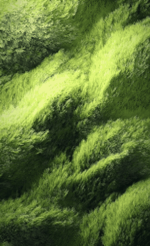
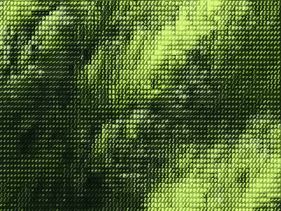

# living-ascii

**Bring a still image to life as a seamless ASCII loop.**

The image is rebuilt as hundreds of thousands of individual strands that sway in the wind like a school of fish — whole regions turning together, each strand with a little motion of its own. On top sits an ASCII layer where **every character turns with the strand beneath it**.

[中文说明](README.zh-CN.md)

<p>
  
  
</p>

Everything is custom shaders on three.js — no text objects, no fonts. It renders in your browser and exports an MP4 whose last frame flows straight back into the first.

## Quick start

Requires [Node.js](https://nodejs.org) 18+.

```bash
git clone https://github.com/yusen-dev/living-ascii.git
cd living-ascii
npm install
npm start
```

Open <http://localhost:5177> to see the sample live.

To use your own image, put it in `input/` and open `http://localhost:5177/?img=input/your-image.jpg`.

## Export a video

Add `export` to the URL and keep the tab in front until it says `done`:

```
http://localhost:5177/?img=input/your-image.jpg&export=ascii,flow
```

You get `out/your-image-ascii.mp4` (the ASCII version) and `out/your-image-flow.mp4` (the strands without the ASCII layer). Then check that the loop has no visible jump:

```bash
npm run check -- out/your-image-ascii.mp4
```

## Options

All set in the URL, e.g. `?img=input/x.jpg&wind=20&amp=1.3`.

| Parameter | Default | What it does |
|---|---|---|
| `img` | — | Image to bring to life (path inside the repo) |
| `mode` | `ascii` | `ascii` or `flow` (strands only). Press **M** to switch |
| `width` | `1080` | Output width in px; height follows the image |
| `wind` | `auto` | Wind direction in degrees (0 = right, 90 = up). `auto` follows the texture's own direction |
| `light` | `130` | Where the light in your image comes from, in degrees (130 = upper left) |
| `amp` | `1` | Sway amount |
| `density` | `1` | Strand count multiplier |
| `loop` | `12` | Loop length in seconds |
| `fps` | `30` | Export frame rate |
| `t` | — | Freeze at a point in the loop (0–1), for stills |
| `export` | — | `ascii`, `flow` or both — render one loop and encode MP4s |

Space pauses.

## Best images

Anything made of many fine strokes running in a direction: grass, wheat, fur, hair, reeds, brush-stroke paintings, wind-swept water. Busy scenes with hard edges (buildings, faces) work less well — the strands smear their outlines.

## How it works

1. **Read the image.** Blur its brightness at two scales to get the big hills and the small tufts, and use a structure tensor to find which way the texture runs at every point.
2. **Rebuild it as strands.** ~160k strands (for a 1080×1772 frame), each a 7-segment ribbon that carries the colour of the image it covered at rest and points along the texture.
3. **Move them like a school of fish.** One heading field sweeps over all strands: a broad turning wave, drifting sub-groups that turn at their own moments, a slow lean of the whole field, and a small motion per strand. Tips lag roots, so every turn whips up the strand.
4. **Light.** A sun swinging around the image's own light relights the hills, cloud-gap light pools drift across, and strands flash as they turn across the sun.
5. **ASCII.** A second pass renders each strand's heading instead of its colour. Every 5×7 cell picks one of 32 stroke glyphs — 8 angles × 4 weights, each weight lighting the same number of pixels at every angle — to match the strands under it. Colour is solved per cell so that at viewing size it averages back to the original image: no blown highlights, no neon, no crushed shadows.
6. **Loop.** Every moving term repeats a whole number of times per loop, so the last frame meets the first exactly.

## Files

```
src/maps.js      image → height and strand-direction maps
src/field.js     strands, motion and light (vertex + fragment shaders)
src/ascii.js     the ASCII layer: stroke atlas and per-cell colour solve
src/post.js      render targets, flow grade, mode switch
src/main.js      URL options, live preview, frame export
server.mjs       local server + ffmpeg encoding
scripts/check-loop.mjs   seamless-loop check
SKILL.md         instructions for Claude Code / AI agents
```

## Use it as a Claude Code skill

`SKILL.md` teaches an agent the whole workflow, including the checks. Copy the repo into your skills folder:

```bash
git clone https://github.com/yusen-dev/living-ascii.git ~/.claude/skills/living-ascii
```

Then ask Claude Code something like *"bring this image to life as an ASCII loop"*.

## Credits

Made with Claude Opus 5.5. Inspired by [ascii-diorama](https://github.com/JDhruv14/ascii-diorama).

MIT licensed.
