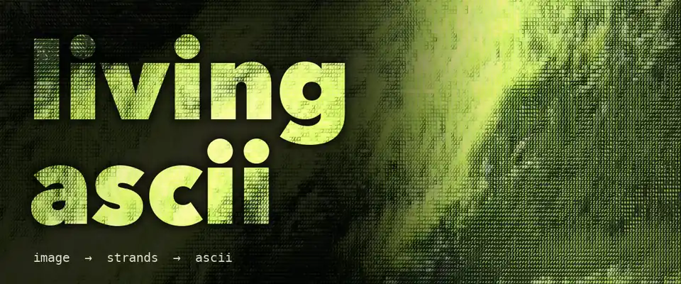
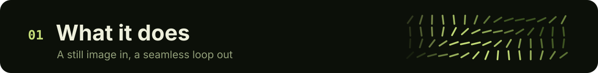
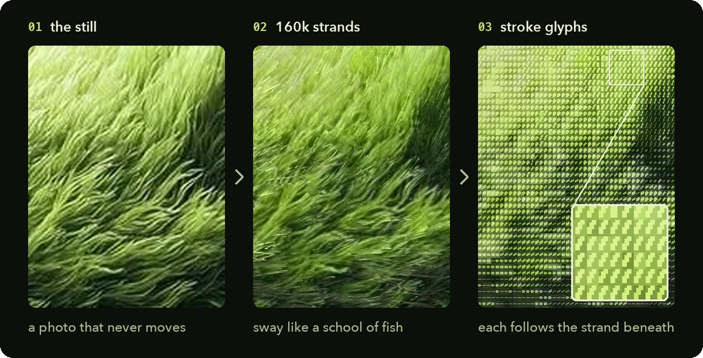
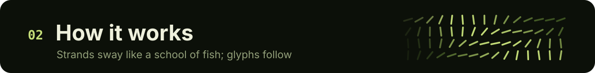
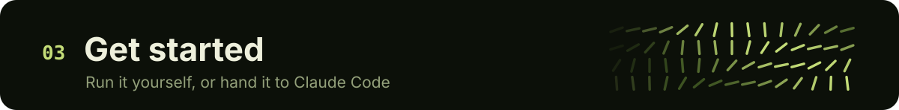
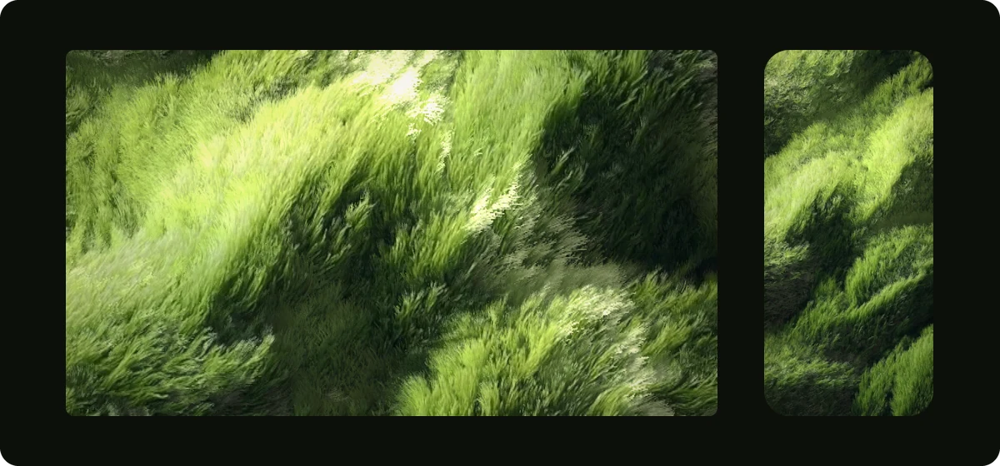

<p align="right">
  <strong>English</strong> · <a href="./README.zh-CN.md">简体中文</a>
</p>

<p align="center">
  
</p>

<h3 align="center">Bring a still image to life as a seamless ASCII loop</h3>

<p align="center">
  Every blade sways in the wind, and every character turns with the blade beneath it.<br>
  Custom shaders on three.js, rendered live in your browser, exported as an MP4 that loops without a seam.
</p>

<br>

<p align="center">
  
</p>

<p align="center">
  
</p>

- **Works on your image.** Drop one in; the wind follows the image's own texture by default.
- **Characters turn.** When a strand turns, the glyph on top of it turns too. It is not a static filter.
- **Colour stays true.** No blown highlights, no neon, no crushed shadows.
- **Seamless.** The last frame flows straight back into the first, so it can loop forever.

<br>

<p align="center">
  
</p>

1. **Read the image.** Blur its brightness at two scales to get the big hills and the small tufts, and use a structure tensor to find which way the texture runs at every point.
2. **Rebuild it as strands.** About 160k strands for a 1080×1772 frame, each a 7-segment ribbon carrying the colour of the patch it covered at rest.
3. **Move them like a school of fish.** Turning waves sweep across, sub-groups drift and turn at their own moments, the whole field leans slowly, and each strand adds a little motion of its own. Tips lag roots, so every turn whips up the strand.
4. **Light.** A sun swings around the image's own light direction, light pools drift through cloud gaps, and strands flash as they turn across the sun.
5. **ASCII.** A second pass records each strand's heading. Every 5×7 cell picks one of 32 stroke glyphs (8 angles × 4 weights) to match. Each weight lights the same number of pixels at every angle, so horizontal strands don't read darker than diagonal ones. Colour is solved per cell so it averages back to the image.
6. **Loop.** Every moving term repeats a whole number of times per loop.

<br>

<p align="center">
  
</p>

### Just want the wallpaper?

<p align="center">
  
</p>

| Download | Size |
|---|---|
| [**Desktop**](https://github.com/yusen-dev/living-ascii/releases/download/wallpapers-v1/grass-desktop-4k.mp4) | 3840×2160 (4K, 16:9) |
| [**Phone**](https://github.com/yusen-dev/living-ascii/releases/download/wallpapers-v1/grass-phone.mp4) | 1290×2796 |

Each is a 12-second loop at 30 fps. The last frame flows straight back into the first, so it repeats without a jump. To set it:

- **Windows**: import the video into Wallpaper Engine.
- **Mac**: macOS can't use a video as a wallpaper by itself. Install a live-wallpaper app from the App Store and add the video.
- **Android**: most phones can set a video as a live wallpaper straight from the gallery.
- **iPhone**: iOS has no looping video wallpaper. You can turn a few seconds into a Live Photo for the lock screen.

For your own image or your screen's exact size, see **Make a wallpaper** below.

### Option 1 · Run it yourself

Requires [Node.js](https://nodejs.org) 18+.

```bash
git clone https://github.com/yusen-dev/living-ascii.git
cd living-ascii
npm install
npm start
```

Open <http://localhost:5177> to see the sample. To use your own image, put it in `input/` and open `http://localhost:5177/?img=input/your-image.jpg`.

**Export a video.** Add `&export=ascii,flow` to the URL and keep the tab in front until it says `done`. You get `out/your-image-ascii.mp4` and `out/your-image-flow.mp4` (the strands without the ASCII layer). Then check the loop has no visible jump:

```bash
npm run check -- out/your-image-ascii.mp4
```

**Make a wallpaper.** Set `width` and `height` to your screen's resolution, e.g. `&width=2560&height=1600`. The image is cropped to that shape, and `focus=0.5,0.3` picks which part to keep (0–1 across, 0–1 down). Render at the screen's full resolution: the characters are 5×7 pixels, so they blur if the video is scaled up.

### Option 2 · Hand it to Claude Code

Install the repo as a skill:

```bash
git clone https://github.com/yusen-dev/living-ascii.git ~/.claude/skills/living-ascii
```

Then give Claude Code your image and say:

```text
Use living-ascii to bring this image to life as an ASCII loop
```

[`SKILL.md`](SKILL.md) walks it through the whole job: judging whether the image suits the effect, tuning wind and light, exporting, then checking the loop, the motion and the colour.

### Best images

Anything made of many fine strokes running in a direction: grass, wheat, fur, hair, reeds, brush-stroke paintings, wind-swept water. Hard-edged subjects (buildings, faces, text) work less well, because the strands smear their outlines.

<details>
<summary><strong>All options</strong></summary>
<br>

All set in the URL, e.g. `?img=input/x.jpg&wind=20&amp=1.3`.

| Parameter | Default | What it does |
|---|---|---|
| `img` | the sample | Image to bring to life (path inside the repo) |
| `mode` | `ascii` | `ascii` or `flow` (strands only). Press **M** to switch |
| `width` | `1080` | Output width in px |
| `height` | follows the image | Output height in px. With `width` also set, the image is cropped to that shape |
| `focus` | `0.5,0.5` | Which part of the image to keep when cropping (0–1 across, 0–1 down) |
| `wind` | `auto` | Wind direction in degrees (0 = right, 90 = up). `auto` follows the texture's own direction |
| `light` | `130` | Where the light in your image comes from, in degrees (130 = upper left) |
| `amp` | `1` | Sway amount |
| `density` | `1` | Strand count multiplier |
| `loop` | `12` | Loop length in seconds |
| `fps` | `30` | Export frame rate |
| `t` | — | Freeze at a point in the loop (0–1), for stills |
| `export` | — | `ascii`, `flow` or both: render one loop and encode MP4s |

Space pauses.

</details>

<details>
<summary><strong>Files</strong></summary>
<br>

```
src/maps.js      image → height and strand-direction maps
src/field.js     strands, motion and light (vertex + fragment shaders)
src/ascii.js     the ASCII layer: stroke atlas and per-cell colour solve
src/post.js      render targets, flow grade, mode switch
src/main.js      URL options, live preview, frame export
server.mjs       local server + ffmpeg encoding
scripts/check-loop.mjs   seamless-loop check
SKILL.md         instructions for Claude Code / AI agents
```

</details>

<br>

<p align="center">
  Made with Claude Opus 5.5 · Inspired by <a href="https://github.com/JDhruv14/ascii-diorama">ascii-diorama</a> · MIT licensed
</p>
