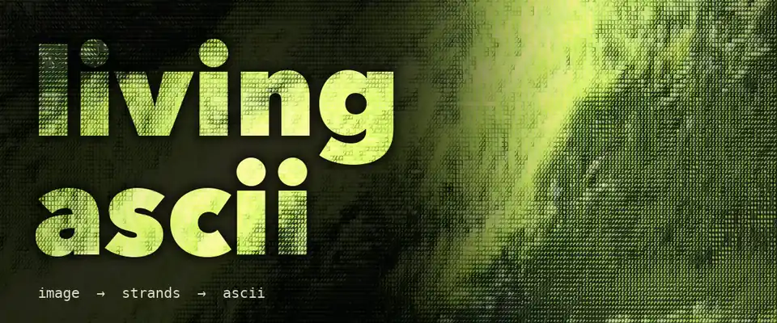
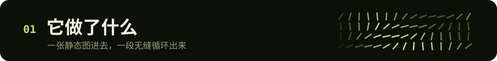
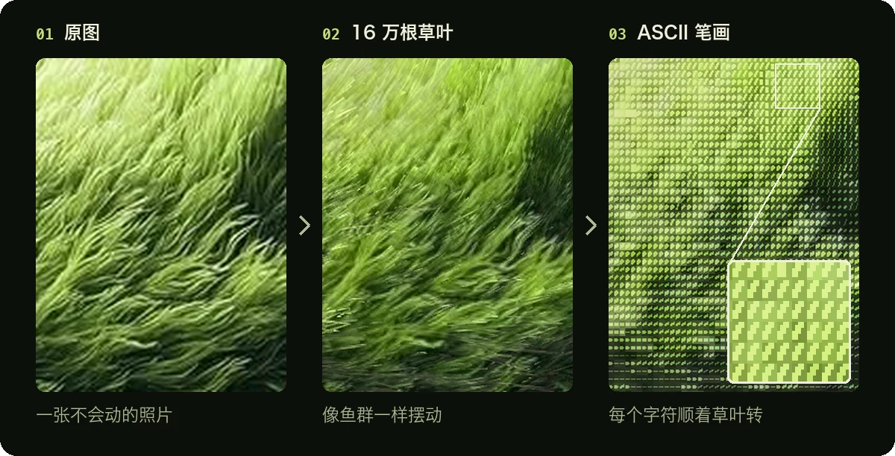
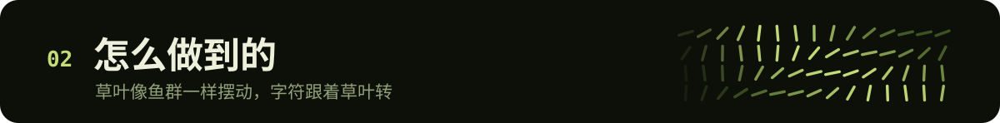
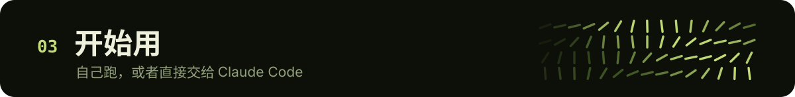
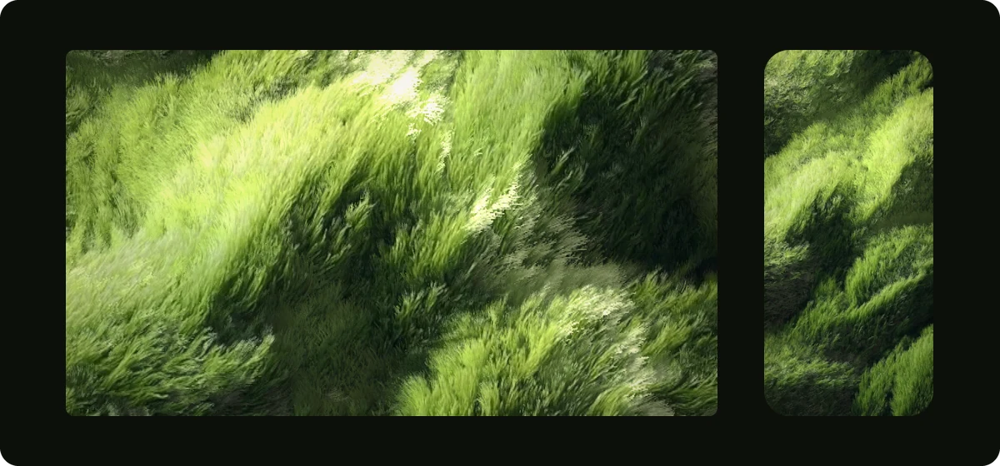

<p align="right">
  <a href="./README.md">English</a> · <strong>简体中文</strong>
</p>

<p align="center">
  
</p>

<h3 align="center">把一张静态图，变成无缝循环的 ASCII 动画</h3>

<p align="center">
  每根草都在随风摆，每个字符都跟着底下的草一起转。<br>
  three.js + 自定义 shader，在浏览器里实时渲染，导出首尾无缝衔接的 MP4。
</p>

<br>

<p align="center">
  
</p>

<p align="center">
  
</p>

- **任何图都能用**：放一张图进去，风向默认沿着图片自己的纹理，不用手动调。
- **字符会转**：草叶一转，盖在上面的字符跟着转，不是一层静止的滤镜。
- **颜色和原图一致**：高光不过曝、不发荧光，阴影也不会死黑。
- **无缝循环**：最后一帧精确接回第一帧，可以直接无限循环播放。

<br>

<p align="center">
  
</p>

1. **读图**：把亮度按大小两种尺度模糊，得到大的起伏和小的草团；再用结构张量算出每个位置的纹理走向。
2. **拆成草叶**：大约 16 万根（1080×1772 的画面），每根是一条 7 段的细带，带着它静止时盖住的那块原图颜色。
3. **像鱼群一样动**：一道道转向波扫过画面，几群“小鱼群”漂移着各自转向，整片缓慢左右偏，每根再加一点自己的颤动。草尖比草根慢半拍，所以转向时有甩动感。
4. **光影**：太阳绕着原图本来的光源方向摆动，云缝里的光斑漂过，草叶转到迎光角度时会闪一下。
5. **ASCII**：再渲染一遍，这次记录每根草叶此刻的朝向。每个 5×7 的格子从 32 种笔画里（8 个角度 × 4 档粗细）挑一个方向一致的；同一档在各个角度点亮的像素数相同，所以横着的草不会比斜着的暗。颜色逐格计算，远看的平均色等于原图。
6. **循环**：所有动态项在一个循环里都重复整数次。

<br>

<p align="center">
  
</p>

### 只想要壁纸？

<p align="center">
  
</p>

| 下载 | 尺寸 |
|---|---|
| [**电脑版**](https://github.com/yusen-dev/living-ascii/releases/download/wallpapers-v1/grass-desktop-4k.mp4) | 3840×2160（4K，16:9） |
| [**手机版**](https://github.com/yusen-dev/living-ascii/releases/download/wallpapers-v1/grass-phone.mp4) | 1290×2796 |

两个都是 12 秒、30 帧的循环，最后一帧精确接回第一帧，循环播放不会跳。设置方法：

- **Windows**：导入 Wallpaper Engine。
- **Mac**：系统本身不能用视频当壁纸，在 App Store 装一个动态壁纸软件，把视频加进去。
- **安卓**：大部分手机可以直接在相册里把视频设成动态壁纸。
- **iPhone**：iOS 不支持循环视频壁纸，只能截几秒转成实况照片放在锁屏。

想用自己的图，或者按自己屏幕的尺寸做，看下面的「做成壁纸」。

### 方式一 · 自己跑

需要先安装 [Node.js](https://nodejs.org) 18 或以上版本。

```bash
git clone https://github.com/yusen-dev/living-ascii.git
cd living-ascii
npm install
npm start
```

打开 <http://localhost:5177> 就能看到示例。换成你自己的图：把图放进 `input/`，打开 `http://localhost:5177/?img=input/你的图片.jpg`。

**导出视频**：网址后面加上 `&export=ascii,flow`，保持标签页在前台，直到左下角显示 `done`。会得到 `out/你的图片-ascii.mp4` 和 `out/你的图片-flow.mp4`（不带 ASCII 层的草叶版）。然后检查循环有没有跳帧：

```bash
npm run check -- out/你的图片-ascii.mp4
```

**做成壁纸**：把 `width` 和 `height` 设成你屏幕的分辨率，比如 `&width=2560&height=1600`。图片会按这个比例裁切，`focus=0.5,0.3` 决定保留哪一块（横向 0–1，纵向 0–1）。一定要按屏幕的原生分辨率导出：每个字符只有 5×7 像素，视频被放大后字符就糊了。

### 方式二 · 交给 Claude Code

把仓库装成 skill：

```bash
git clone https://github.com/yusen-dev/living-ascii.git ~/.claude/skills/living-ascii
```

然后把图片发给 Claude Code，说一句：

```text
用 living-ascii 把这张图做成 ASCII 循环动画
```

[`SKILL.md`](SKILL.md) 会带它走完整个流程：判断图片合不合适、调风向和光源、导出，最后检查循环、动态幅度和颜色。

### 什么图效果最好

由大量朝同一方向的细笔触组成的画面：草地、麦田、毛发、头发、芦苇、笔触明显的油画、被风吹皱的水面。边缘很硬的画面（建筑、人脸、文字）会被草叶拉花，效果会差一些。

<details>
<summary><strong>全部参数</strong></summary>
<br>

都写在网址里，比如 `?img=input/x.jpg&wind=20&amp=1.3`。

| 参数 | 默认值 | 作用 |
|---|---|---|
| `img` | 示例图 | 要处理的图片（仓库里的路径） |
| `mode` | `ascii` | `ascii` 或 `flow`（只有草叶）。按 **M** 键切换 |
| `width` | `1080` | 输出宽度（像素） |
| `height` | 按图片比例 | 输出高度（像素）。和 `width` 一起设置时，图片会裁成这个比例 |
| `focus` | `0.5,0.5` | 裁切时保留图片的哪一块（横向 0–1，纵向 0–1） |
| `wind` | `auto` | 风向，单位是度（0 = 向右，90 = 向上）。`auto` 沿着图片本身的纹理方向 |
| `light` | `130` | 图片里光从哪个方向来，单位是度（130 = 左上方） |
| `amp` | `1` | 摆动幅度 |
| `density` | `1` | 草叶数量倍数 |
| `loop` | `12` | 循环时长（秒） |
| `fps` | `30` | 导出帧率 |
| `t` | — | 定格在循环中的某个时刻（0–1），用来截静帧 |
| `export` | — | `ascii`、`flow` 或两个都要：渲染一个完整循环并编码成 MP4 |

按空格键暂停。

</details>

<details>
<summary><strong>文件结构</strong></summary>
<br>

```
src/maps.js      图片 → 起伏图和纹理方向图
src/field.js     草叶、动态和光影（顶点 + 片元 shader）
src/ascii.js     ASCII 层：笔画字形表和逐格配色
src/post.js      渲染目标、flow 调色、模式切换
src/main.js      网址参数、实时预览、逐帧导出
server.mjs       本地服务器 + ffmpeg 编码
scripts/check-loop.mjs   无缝循环检查
SKILL.md         给 Claude Code / AI agent 的使用说明
```

</details>

<br>

<p align="center">
  用 Claude Opus 5.5 制作 · MIT 协议
</p>
